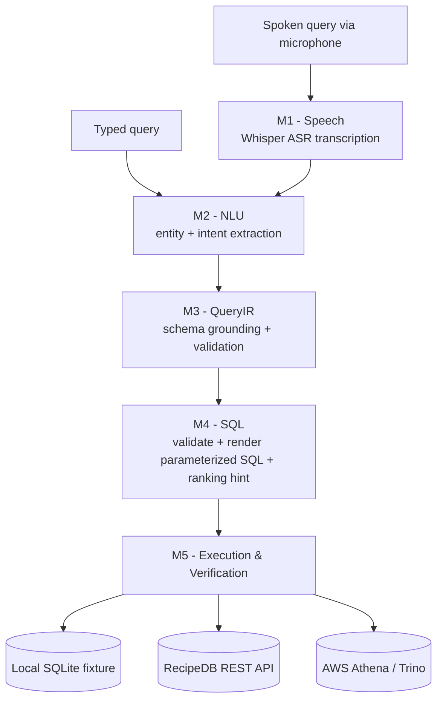
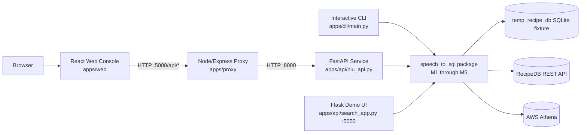
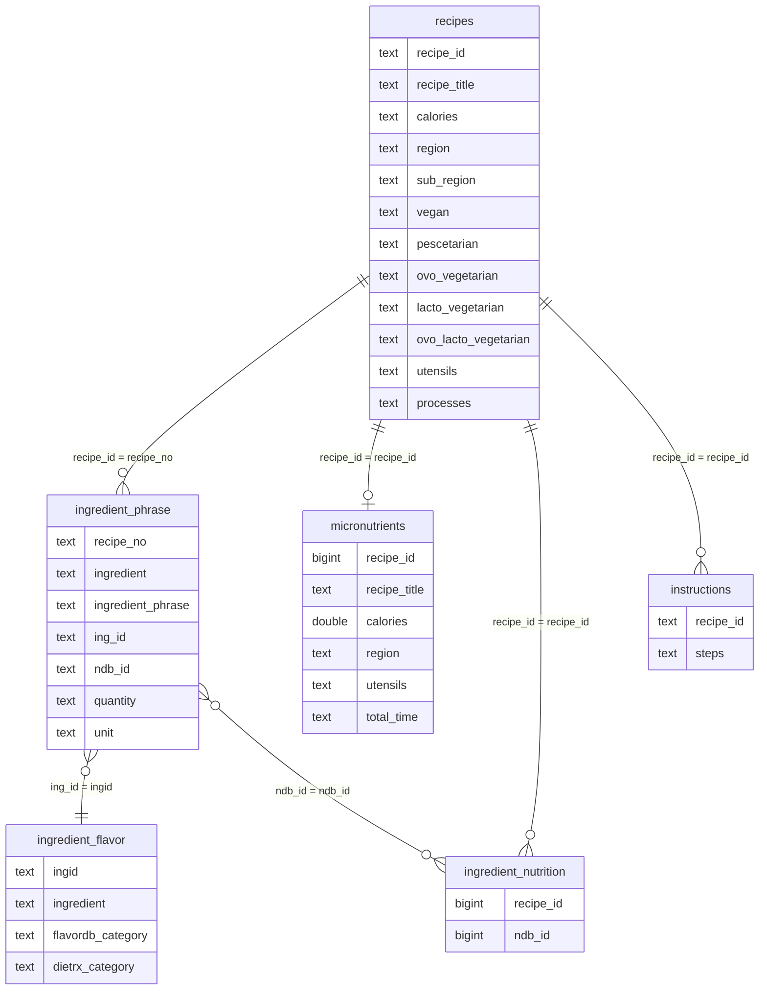

# Speech-to-SQL for RecipeDB

A pipeline that turns a **spoken or typed recipe query** — in English, Hindi, or
code-mixed Hinglish — into **safe, schema-validated, parameterized SQL** against
IIITD CoSy Lab's [RecipeDB](http://cosylab.iiitd.edu.in:6969) nutrition/recipe
database, with a local verification harness that proves the generated SQL is
correct before it ever touches a real database.

> *"vegan recipes with spinach under 300 calories"* becomes a validated join
> across `recipes` and `ingredient_phrase`, executes against a local SQLite
> fixture, and returns 11 verified rows — all in under a second, with every
> intermediate stage (transcript → entities → QueryIR → SQL → results)
> inspectable. See the [full worked example](#10-end-to-end-walkthrough-a-real-captured-run).


---

## Table of Contents

1. [Overview](#1-overview)
2. [Key Features](#2-key-features)
3. [System Architecture](#3-system-architecture)
4. [Repository Structure](#4-repository-structure)
5. [The Five-Stage Pipeline](#5-the-five-stage-pipeline)
   - [M1 — Speech](#51-m1--speech)
   - [M2 — NLU](#52-m2--nlu)
   - [M3 — QueryIR](#53-m3--queryir)
   - [M4 — SQL](#54-m4--sql)
   - [M5 — Execution & Verification](#55-m5--execution--verification)
6. [The QueryIR Contract](#6-the-queryir-contract)
7. [Database Schema](#7-database-schema)
8. [Configuration System](#8-configuration-system)
9. [Machine Learning Components](#9-machine-learning-components)
10. [End-to-End Walkthrough (a real, captured run)](#10-end-to-end-walkthrough-a-real-captured-run)
11. [Result Ranking (Dish-Title Boost)](#11-result-ranking-dish-title-boost)
12. [Applications & Interfaces](#12-applications--interfaces)
13. [Installation & Setup](#13-installation--setup)
14. [Environment Variables](#14-environment-variables)
15. [Running & Verification](#15-running--verification)
16. [Testing](#16-testing)
17. [API Reference](#17-api-reference)
18. [Known Limitations & Notes](#18-known-limitations--notes)
19. [Next-Semester Extension Roadmap](#19-next-semester-extension-roadmap)
20. [Project Timeline & Contributors](#20-project-timeline--contributors)
21. [Acknowledgments](#21-acknowledgments)
22. [License](#22-license)

---

## 1. Overview

Most "talk to your database" demos skip the hard part: they let a language
model write SQL directly, which means every query is one hallucination away
from a wrong join, a dropped filter, or a syntax error against a real schema.

This project takes the opposite approach. Natural language is only ever used
to build a **structured intent**, and that intent is only ever converted to
SQL through a **fixed, auditable QueryIR (Query Intermediate Representation)
contract** that is validated against `config/sql_schema.json` before a single
character of SQL is rendered. No language model — local or remote — is ever
allowed to emit raw SQL. If the intent can't be grounded against the real
schema, the pipeline fails loudly instead of guessing.

The domain is recipe search over RecipeDB: ingredients, dietary styles
(vegan/vegetarian/pescatarian/gluten-free/...), cooking utensils, cooking
actions, nutrition thresholds (calories, protein, fat, sodium, ...), cuisine
regions, cooking time, and instruction-step content — expressed in free-form
English, Hindi, or the code-mixed Hinglish that Indian home cooks actually
speak ("mujhe adrak aur haldi wali recipe chahiye").

The system is organized as five modules, **M1 through M5**, each with a single
well-defined responsibility, connected by plain Python dictionaries and
dataclasses rather than hidden global state:

```
speech / text  →  entities  →  grounded QueryIR  →  parameterized SQL  →  verified results
     M1              M2              M3                   M4                    M5
```

A sixth, lighter-weight concern — **ranking** query results once they're
already correct — was added most recently and lives inside M4/the Athena
renderer rather than as its own numbered module; see
[§11](#11-result-ranking-dish-title-boost).

---

## 2. Key Features

- **Multilingual entity extraction.** Ingredients, utensils, and cooking
  actions are recognized in English, Hindi, and Hinglish transliterations
  (`adrak` → ginger, `haldi` → turmeric, `jeera` → cumin, `lehsun` → garlic)
  against a ~19,000-row ingredient lexicon, using exact matching first and
  fuzzy/phonetic recovery for noisy speech-to-text output.
- **No LLM ever writes SQL.** M2/M3 may use models to help understand the
  *query*, but only a validated `QueryIR` object reaches the SQL renderer in
  M4. The contract layer (`query_ir_contract.py`) explicitly rejects payloads
  that try to smuggle in `sql`, `raw_sql`, `where`, or `join` keys.
- **Multi-layer, self-supervised entity matching.** Aho-Corasick exact
  matching → RapidFuzz fuzzy matching → Metaphone/Levenshtein/G2P phonetic
  rescue → an optional trained `LogisticRegression` reranker that scores
  candidates using confidence features, with an automatic fallback to raw
  extractor output if the model is missing or fails to load.
- **Rule + ML SQL-operator detection.** Explicit SQL cues ("under", "at
  least", "top 5") are caught by rules and a lexicon; a fine-tuned DistilBERT
  token-classification model can catch spans the rules miss; a second
  DistilBERT multi-label sequence classifier predicts *implicit* clauses
  (`SELECT`, `WHERE`, `COUNT`, `ORDER BY`, `LIMIT`) that never appear as
  visible text.
- **Adjacent-ingredient dish-title ranking.** When two or more matched
  ingredients sit next to each other separated only by whitespace (e.g.
  "butter chicken"), M4 attaches a lightweight `dish_title_boost` hint. The
  Athena renderer uses it purely to **order** results by how closely the
  recipe title matches that phrase — it never adds a hard title filter and
  never reclassifies the query as a "find this dish" query. See
  [§11](#11-result-ranking-dish-title-boost).
- **Adaptive lexicon.** Manual corrections logged from the CLI, API, or web
  UI (`/feedback/*` endpoints) are folded back into transcript normalization
  and used to retrain the ingredient reranker and SQL-clause classifier.
- **Schema-grounded, dual-dialect SQL rendering.** The same `QueryIR` renders
  to SQLite-compatible SQL (for local verification) and to
  Trino/Athena-compatible SQL (for the production RecipeDB Athena table),
  with dialect-specific casting, delimiter-safe token matching for
  comma/`||`-joined text columns, and identifier quoting handled centrally.
- **Semantic guard rails.** `vegan` + a blocked ingredient category (Meat,
  Dairy, Seafood, Fish) is detected as a semantic conflict rather than
  silently returning zero rows and calling it a bug.
- **A full local verification harness**, not just unit tests: a generated
  SQLite fixture (`temp_recipe_db/`), a schema auditor that diffs
  `config/sql_schema.json` against `config/schema.sql`, and a configurable
  stress-test generator (`scripts/stress_verify_queries.py`) that builds
  hundreds of natural-language cases across ten query categories and checks
  the *rows returned*, not just "did SQL compile."
- **Three ways to use it**: an interactive terminal CLI with a full
  module-by-module pipeline report, a FastAPI service backing a React "workbench"
  web console (with a Node/Express proxy in front) whose Athena SQL panel is
  directly editable, and a standalone Flask demo page.
- **Two execution backends**: a live RecipeDB REST API client (rate-limited,
  cached, with pluggable per-intent endpoint planning) and an AWS Athena
  client for executing the Trino-dialect SQL directly, runnable straight from
  the web console.

---

## 3. System Architecture

### 3.1 Pipeline data flow



Typed queries skip M1 entirely and feed straight into M2 — this is the default
path for the API, web console, and most local testing, since it removes ASR
latency and variance from the loop.

### 3.2 Application / deployment topology



Four independent front doors sit on top of the same `speech_to_sql` core
package, so behavior can't silently drift between the CLI demo and the web
demo — they call the exact same M1–M5 functions.

---

## 4. Repository Structure

```text
IP_Project/
├── apps/
│   ├── api/
│   │   ├── nlu_api.py          FastAPI service: /tag, /query, /athena/execute,
│   │   │                       /transcribe-and-tag, /extract_sql_operators,
│   │   │                       /extract_sql_clauses, /feedback/*, /health
│   │   └── search_app.py       Standalone Flask demo UI (self-contained HTML/CSS/JS)
│   ├── cli/
│   │   └── main.py             Interactive terminal CLI; full M1-M5 pipeline report
│   ├── proxy/
│   │   ├── index.js            Express proxy: forwards /api/* to the FastAPI service
│   │   └── package.json
│   └── web/
│       └── src/App.js          React "workbench" UI, one tab per pipeline module,
│                                with an editable/re-runnable Athena SQL panel
│
├── src/speech_to_sql/
│   ├── common/
│   │   └── config.py           Loads config/recipe_db.json, config/sql_schema.json, .env
│   ├── m1_speech/
│   │   └── transcriber.py      Whisper-based WAV -> text transcription
│   ├── m2_nlu/
│   │   ├── entity_tagger.py    tag_entities(): the M2 public entry point
│   │   ├── extractor.py        Aho-Corasick + fuzzy + phonetic ingredient/utensil/action matching
│   │   ├── automaton.py        Aho-Corasick automaton builders
│   │   ├── adaptive_lexicon.py Feedback-driven transcript normalization
│   │   ├── semantic_normalizer.py  Number words, time units, SQL-operator lexicon matching
│   │   ├── entity_confidence.py    Self-supervised confidence scoring for utensils/actions
│   │   ├── ingredient_reranker.py  DictVectorizer + LogisticRegression reranker
│   │   ├── query_decomposer.py     Include/exclude/AND/OR ingredient-logic decomposition
│   │   ├── intent_sql_mapper.py    Legacy ingredient-only WHERE-clause plan
│   │   ├── sql_plan_builder.py     Legacy unified (ingredients+nutrition+diet) plan
│   │   ├── sql_ops/                SQL keyword/operator extraction sub-package (see below)
│   │   ├── data/                   CSV lexicons, synonym maps, feedback logs
│   │   ├── datasets/               Raw/processed training data for the ML sub-models
│   │   └── models/                 Checked-in trained model artifacts (see §9)
│   ├── m3_query_ir/
│   │   ├── intent_preparer.py      Orchestrates enrich -> link -> ground -> nutrition-scope
│   │   ├── intent_enricher.py      Adds implicit filters (e.g. "low carb" -> carbs <= 50)
│   │   ├── schema_linker.py        Resolves aliases to real schema field names
│   │   ├── intent_grounder.py      Proves every filter maps to a real table/column
│   │   ├── nutrition_scope.py      Recipe-level vs ingredient-level nutrition disambiguation
│   │   ├── schema_registry.py      Typed view over config/sql_schema.json (roots, joins)
│   │   ├── sql_intent_builder.py   build_query_ir(): the M3 public entry point
│   │   ├── sql_ir.py               QueryIR / Predicate / SelectExpr / OrderBy dataclasses
│   │   ├── query_ir_contract.py    Structural + semantic validation of a QueryIR payload
│   │   ├── query_relaxer.py        Progressive predicate relaxation when a query is too strict
│   │   ├── sort_resolver.py        "highest protein" / "quickest" -> ORDER BY resolution
│   │   └── time_resolver.py        Cook/prep/total time filter resolution
│   ├── m4_sql/
│   │   ├── sql_query_builder.py    build_sql_query(): the M4 public entry point;
│   │   │                           also computes the dish_title_boost ranking hint (§11)
│   │   ├── sql_validator.py        Validates a QueryIR against the schema contract
│   │   ├── sql_plan_builder.py     QueryIR -> SqlPlan (joins, WHERE conditions, ORDER BY)
│   │   ├── sql_renderer.py         SqlPlan -> parameterized SQLite-dialect SQL string
│   │   ├── athena_renderer.py      SQLite-dialect SQL -> Trino/Athena-dialect SQL,
│   │   │                           and applies the dish-title ranking ORDER BY (§11)
│   │   └── schema_audit.py         Diffs sql_schema.json against schema.sql / the source PDF
│   └── m5_execution/
│       ├── query_planner.py        Intent -> ranked list of RecipeDB API call plans
│       ├── client.py               RecipeDBClient: rate-limited, cached REST client
│       ├── athena_client.py        boto3-based AWS Athena query execution
│       ├── api_verifier.py         Verifies API results actually satisfy every predicate
│       ├── result_merger.py        De-duplicates recipes across multiple API calls
│       ├── post_filter.py          Client-side re-filtering safety net
│       ├── ranker.py               Sorting + LIMIT application
│       └── search.py               search_text(): orchestrates the whole M2-M5 search flow
│
├── config/
│   ├── recipe_db.json          RecipeDB API endpoints, aliases, sort/time/diet config
│   ├── schema.sql              Human-readable physical schema contract (6 tables)
│   └── sql_schema.json         Executable schema contract (roots, joins, guards, operators)
│
├── data/
│   ├── generated_cases/        360 generated NL -> expected-SQL-shape test cases
│   └── query_cache/            Optional local API-discovery cache
│
├── temp_recipe_db/
│   ├── seed_temp_db.py         Builds a 100-recipe local SQLite fixture from the schema
│   └── run_query.py            Runs a query through the pipeline and verifies it against the fixture
│
├── scripts/
│   ├── run_cli.py               Wrapper for apps/cli/main.py
│   ├── smoke_query.py           Quick single-query smoke test
│   ├── stress_verify_queries.py Generates + verifies hundreds of NL queries against the fixture
│   ├── api_stress_verify.py     Same idea, against the live RecipeDB API
│   ├── generate_nlp_sql_cases.py Regenerates data/generated_cases/
│   ├── athena_query.py          Ad-hoc Athena SQL runner from the terminal
│   ├── inspect_utensils.py      Debug helper for utensil-extraction spot checks
│   └── microphone_demo.py       Minimal standalone mic -> Whisper -> text smoke test
│
├── tests/
│   ├── unit/                    pytest suite: 203 tests across 4 files (see §16)
│   └── integration/             Larger standalone NLU regression suites (~1200+ cases)
│
├── docs/
│   ├── README.md                             Index of the docs below
│   ├── project_structure.md                  Repository layout reference
│   ├── pipeline_architecture.md               M1-M5 pipeline reference
│   ├── running_and_verification.md            CLI / dummy-DB / test / audit commands
│   ├── ml_models.md                           Which local ML models exist and when
│   ├── professor_verification_plan.md         Exact grading/verification reproduction steps
│   └── next_semester_extension_architecture.md  4-month roadmap for a generalized,
│                                                 multi-backend, ranking-aware version (§19)
├── requirements.txt
├── pytest.ini
└── README.md                    (this file)
```

---

## 5. The Five-Stage Pipeline

### 5.1 M1 — Speech

**Location:** `src/speech_to_sql/m1_speech/transcriber.py`

A thin wrapper around OpenAI's [Whisper](https://github.com/openai/whisper)
(`small` model by default, lazily loaded and cached per model size). Audio is
captured from the microphone as float32 PCM in the CLI
(`sounddevice.InputStream`), converted to a 16 kHz mono WAV in memory, and
handed to Whisper as a temp file. Two details matter for this domain:

- **`language=None`** enables Whisper's language auto-detection, which is
  deliberately used instead of forcing English — mixed Hindi/English speech
  is the common case for this dataset.
- **A recipe-domain `initial_prompt`** biases decoding toward the expected
  vocabulary (`cumin, coriander, turmeric, paneer, ghee, ... jeera, lahsun,
  mirch`), which measurably improves transcription of Hindi ingredient names
  that a general-purpose ASR model would otherwise mis-hear as unrelated
  English words.

Typed input bypasses M1 completely; `apps/cli/main.py`'s `process_text()`
and the FastAPI `/tag` and `/query` endpoints call M2 directly on the raw
string.

### 5.2 M2 — NLU

**Location:** `src/speech_to_sql/m2_nlu/` · **Entry point:** `tag_entities(text) -> dict`

M2 is the largest and most intricate module (`entity_tagger.py` alone is
~1,700 lines). Given a transcript, it runs six extraction passes **concurrently**
via a `ThreadPoolExecutor` and merges the results:

| Pass | What it finds | Key logic |
|---|---|---|
| Dietary styles | `vegan`, `gluten-free`, `non-vegetarian`, ... (plus **negated** styles, e.g. "not vegan") | keyword table + negation-cue scan |
| Nutrition filters | `calories < 300`, `high protein`, `low sodium`, `between 200 and 400 calories` | `config/recipe_db.json`'s `intent_enrichment.nutrition_qualifiers` lexicon + numeric parsing |
| SQL operators | `under`, `at least`, `top 5`, implicit `SELECT`/`COUNT`/`ORDER BY` | `sql_ops/` sub-package: rules + optional ML (§9) |
| Cooking actions | `saute`, `simmer`, `marinate`, ... | Aho-Corasick over `data/actions.csv` (270 actions) |
| Categories | ingredient-category synonyms ("leafy green", "root vegetable", "nightshade") | `CATEGORY_SYNONYMS` + `ingredient_flavor_aliases` |
| Utensils | `skillet`, `oven`, `blender`, ... | Aho-Corasick over `data/utensils.csv` (70 utensils) + synonym map |

Ingredient extraction (`extractor.py`, ~1,580 lines) is the most layered part
of the system, run as a **four-stage cascade** over a ~19,000-row ingredient
lexicon (`data/RecipeDB_Ingredient_Category.csv`):

1. **Exact matching** — an Aho-Corasick automaton (`pyahocorasick`) over
   canonical ingredient names *and* every known synonym/Hindi transliteration,
   found via `automaton.py`. This is O(text length), not O(vocabulary size),
   so it stays fast even at 19k entries.
2. **Fuzzy matching** — RapidFuzz token-set/partial-ratio scoring for
   unigram/bigram/trigram windows, with separate thresholds
   (`UNIGRAM_THRESHOLD=85`, `BIGRAM_THRESHOLD=86`, `TRIGRAM_THRESHOLD=82`) and
   a "grey zone" (`GREY_ZONE_LOW=78`) that triggers phonetic rescue instead of
   an outright reject.
3. **Phonetic rescue** — Double Metaphone codes (`Metaphone`) combined with
   Levenshtein edit distance and, for the Hindi-transliteration case, a
   grapheme-to-phoneme model (`g2p-en`) so that ASR slips like "vigan" →
   "vegan" or phonetically-close Hindi spellings still resolve correctly.
4. **ML reranking** (optional, on by default) — `ingredient_reranker.py`
   loads a saved `DictVectorizer + LogisticRegression` pipeline
   (`m2_nlu/models/ingredient_reranker/model.pkl`) that scores every
   candidate using match-layer, edit-distance, and frequency features, and
   suppresses low-confidence extractor noise. **If the model file is
   missing, corrupted, or the wrong schema version, the code deliberately
   falls back to the raw extractor output** — reranking is a precision boost,
   never a hard dependency.

Two smaller but important passes run inside `tag_entities()`:

- **`query_decomposer.py`** turns a flat ingredient list into structured
  include/exclude logic with AND/OR connectors — `"chicken but without
  garlic"` becomes `include=["chicken"], exclude=["garlic"]`, while
  `"either paneer or tofu"` becomes an `OR` group.
- **`adaptive_lexicon.py`** runs *before* extraction and applies
  frequency-gated corrections learned from prior feedback (see
  `data/feedback/transcript_feedback.jsonl`), so a correction a user makes
  once through the UI improves every future query, not just that session.

M2's output is a single dictionary with `ingredients`, `utensils`, `actions`,
`dietary_styles`, `excluded_dietary_styles`, `categories`, `nutrition_filters`,
`sql_operators`, `ingredient_logic`, two **legacy** convenience fields
(`sql_filter_plan`, `unified_sql_plan`) kept only for older demos/debugging,
and two placeholder fields, `dish_titles` (always `[]`) and `title` (always
`None`). Those last two exist only for backward compatibility with older
consumers of the dict — an earlier, separate "is this a request for one named
dish?" classification pass has been intentionally removed from the extraction
cascade (see [§11](#11-result-ranking-dish-title-boost)); dish-looking phrases
now flow through ordinary ingredient extraction, and ranking is handled
downstream in M4/Athena rendering instead. The real SQL path always goes
through M3/M4, not the legacy plan fields.

### 5.3 M3 — QueryIR

**Location:** `src/speech_to_sql/m3_query_ir/` · **Entry point:** `build_query_ir(tag_result) -> QueryIR`

M3 is the layer that turns "what the user probably meant" into "what the
database can actually answer," in four sequential steps orchestrated by
`intent_preparer.prepare_intent()`:

1. **Enrich** (`intent_enricher.py`) — expands implicit phrases the M2 tagger
   didn't already turn into explicit filters, e.g. mapping "low carb" to a
   concrete `carbs <= 50` predicate, resolving relative time phrases, and
   expanding a generic `vegetarian` request into the correct combination of
   `vegan` / `lacto_vegetarian` / `ovo_vegetarian` flags depending on whether
   the query also mentions eggs or dairy (`dietary_style_expansions` in
   `config/recipe_db.json`).
2. **Link** (`schema_linker.py`) — resolves every logical field name and
   alias used so far to the schema's real vocabulary, recording a
   `SchemaLink(source, original, resolved, reason)` for each resolution so
   the mapping is auditable, not implicit.
3. **Ground** (`intent_grounder.py`) — the safety-critical step. For every
   predicate, it proves a concrete `(table, column)` pair exists in
   `config/sql_schema.json` via `SchemaRegistry`, and raises
   `IntentGroundingError` if it can't. Nothing ungrounded reaches SQL
   generation.
4. **Scope nutrition** (`nutrition_scope.py`) — a deliberately careful piece
   of logic that disambiguates *recipe-level* vs *ingredient-level* nutrition
   mentions in the same sentence. `"recipes with spinach where spinach has
   high iron"` and `"recipes with spinach where the full recipe has under
   400 calories"` use the same nutrient vocabulary but must route to
   different physical tables (`ingredient_nutrition` vs the recipe's own
   nutrition columns); this module locates each nutrient mention in the
   original text and measures its clause-local distance to ingredient-scope
   cues ("per ingredient", "ingredient contains", ...) vs recipe-scope cues
   ("full recipe", "whole recipe", "recipe has", ...) to decide.

`sql_intent_builder.build_query_ir()` then converts the prepared, grounded
intent into the actual `QueryIR` dataclass (§6): resolving the query
**root** (does the user mean "recipes", "ingredients", or "instructions"?),
building `Predicate` objects for every ingredient/dietary/nutrition/category/
utensil/action/time filter, resolving sort intent (`sort_resolver.py`) into
`OrderBy` objects, and applying a `LIMIT`. `query_relaxer.py` provides a
fallback chain that can progressively drop the least-important predicate if a
query is proven too strict (used by the verification/demo layer, not by
default SQL generation).

### 5.4 M4 — SQL

**Location:** `src/speech_to_sql/m4_sql/` · **Entry point:** `build_sql_query(tag_result) -> dict`

M4 takes a `QueryIR` — never raw text, never a prompt — and produces SQL in
three steps:

1. **Validate** (`sql_validator.py`, ~640 lines) — re-checks the QueryIR
   against `config/sql_schema.json`: every predicate's source/field/operator
   is legal, value counts match what each operator expects (e.g. `BETWEEN`
   needs exactly 2 values), `LIMIT` doesn't exceed `max_limit` (500), and the
   configured `semantic_guards` are evaluated (see below). Returns a
   `ValidationResult(ok, errors, warnings)` — validation failures are
   reported, not silently swallowed.
2. **Plan** (`sql_plan_builder.py`, ~1,080 lines) — the QueryIR's abstract
   predicates become a concrete `SqlPlan`: which tables to `JOIN` and by
   which foreign key, whether an `EXISTS`/`IN` subquery is more appropriate
   than a join for a given predicate (e.g. multiple *excluded* ingredients),
   how to combine multiple ingredient predicates without accidentally
   cross-multiplying rows, and which literal `WHERE` conditions to emit.
   Every join is justified against `config/sql_schema.json`'s `relationships`
   list, each carrying a `confidence` and `evidence` trail.
3. **Render** (`sql_renderer.py` for SQLite / `athena_renderer.py` for
   Trino-Athena) — the `SqlPlan` becomes an actual parameterized SQL string.
   Two renderers exist because the project has two execution targets with
   different casting/quoting rules (backtick vs double-quote identifiers,
   `CAST(NULLIF(x,''))` vs `TRY_CAST(NULLIF(TRIM(...)))`, `?`
   placeholders vs inlined literals for Athena). Both renderers are driven by
   the *same* `SqlPlan`, so the two dialects can never structurally diverge.

Immediately after compiling the QueryIR, `sql_query_builder.build_sql_query()`
also computes a `dish_title_boost` hint (a small piece of metadata, not SQL)
whenever the query's ingredient list looks like a dish name — see
[§11](#11-result-ranking-dish-title-boost) for the full mechanism. This hint
travels alongside the compiled SQL and is only ever consumed by the Athena
renderer at render time.

**Semantic guards** deserve a callout: `config/sql_schema.json` encodes
known-impossible combinations, e.g. `vegan` blocks the `Meat`/`Dairy`/
`Seafood`/`Fish` ingredient categories. If a grounded, *syntactically valid*
query is also semantically contradictory ("vegan chicken curry"), the
validator flags it as a warning rather than mysteriously returning zero rows
— M5's dummy-DB verifier specifically distinguishes "SQL is broken" from
"SQL is fine, the request just can't be satisfied."

`schema_audit.py` is a separate, standalone auditing tool (not part of the
runtime path) that diffs `config/sql_schema.json` against the readable
`config/schema.sql` (and optionally the original schema PDF) to catch drift
between the two schema representations before it becomes a runtime bug.

### 5.5 M5 — Execution & Verification

**Location:** `src/speech_to_sql/m5_execution/`

M5 has two independent jobs that are easy to conflate but are kept separate
in the code:

**A. Planning and executing against RecipeDB itself.**
`query_planner.plan_queries()` turns a prepared intent into a *ranked* list
of `ApiQueryPlan`s against RecipeDB's REST API — e.g. an ingredient+category
filter routes to the most selective `ingredient_category_title` endpoint
(priority 10) rather than the generic `general` fallback (priority 999).
`client.RecipeDBClient` executes those plans with an in-memory TTL cache and
a configurable minimum request interval (RecipeDB's live API has a **25
requests/minute** trial limit). `result_merger.py` de-duplicates recipes
returned by multiple plans, `post_filter.py` re-applies every predicate
client-side as a safety net against an API that might be more permissive
than requested, `ranker.py` applies sort/limit, and `api_verifier.py`
independently re-checks that every returned recipe actually satisfies every
QueryIR predicate — catching cases where the *SQL* is right but the *live
API* silently ignored a filter.

The planner's `_title_query()` helper — which used to route a query to a
title-search endpoint whenever the tagger produced a `title`/`recipe_title`
field, or a quoted phrase appeared in the text — is now intentionally a
no-op. That dish/title classification path has been retired in favor of the
simpler, purely ranking-side signal described in [§11](#11-result-ranking-dish-title-boost):
dish-looking phrases are matched as ordinary ingredients (so they still
return results even when there's no exact title match), and relevance
ordering is layered on top afterward instead of being decided up front by a
classifier.

**B. Local, no-network verification.** This is the piece that lets the whole
pipeline be demonstrated and graded without any RecipeDB API access at all.
`temp_recipe_db/seed_temp_db.py` builds a 100-recipe SQLite database using
**the exact same schema contract** (`config/sql_schema.json` /
`config/schema.sql`) the SQL generator targets. `temp_recipe_db/run_query.py`
runs a natural-language query through the *real* M1–M4 pipeline, executes the
*real* generated SQL against that fixture, and checks the returned rows
against the original intent (does every row actually contain the requested
ingredient? does every row's calorie value actually satisfy the filter?).
This is what `apps/cli/main.py`'s pipeline report calls **"M5 Execution /
Verification"** by default — the CLI does *not* call the external RecipeDB
API unless explicitly asked to; it shows the *planned* API calls it would
make, and executes/verifies against the local fixture instead. See
`scripts/athena_query.py` and `m5_execution/athena_client.py` for the third
option: sending the Athena-dialect SQL to a real AWS Athena table. Because the
dish-title ranking boost (§11) only ever changes row *order*, never row
*membership*, the local fixture's row-correctness checks are unaffected by
it — the SQLite renderer this harness uses simply doesn't apply the boost.

---

## 6. The QueryIR Contract

Everything downstream of M2 revolves around one small, deliberately boring
data structure (`src/speech_to_sql/m3_query_ir/sql_ir.py`):

```python
@dataclass(frozen=True)
class Predicate:
    source: str                 # "base" | "ingredients" | "dietary" | "instructions" | ...
    field: str                  # logical field name, resolved against the schema
    operator: str                # "=" | "<" | "<=" | ">" | ">=" | "BETWEEN" | "IN" | "LIKE" | "ANY_GT"
    values: tuple[Any, ...]
    quantifier: str = "exists"  # "exists" | "not_exists" | "or_exists"

@dataclass
class QueryIR:
    root: str = "recipe"                 # "recipe" | "ingredients" | "instructions"
    select: list[SelectExpr] = ...
    predicates: list[Predicate] = ...
    order_by: list[OrderBy] = ...
    limit: int | None = None
```

This is the *entire* surface area SQL generation is allowed to see. There is
no field for a raw SQL fragment, and `query_ir_contract.py` actively rejects
any incoming payload that tries to add one (`_FORBIDDEN_SQL_KEYS = {"sql",
"query", "raw_sql", "sql_query", "from", "join", "joins", "where",
"where_clause"}`). This is the architectural decision the whole project rests
on: **language understanding and SQL construction are two different
modules with a narrow, typed, non-negotiable interface between them.** The
ranking hint described in [§11](#11-result-ranking-dish-title-boost) lives
deliberately *outside* this contract, as a sibling piece of metadata attached
to the compiled SQL result rather than a QueryIR field — it can only ever
reorder rows the QueryIR already proved were valid, never change which rows
are selected.

---

## 7. Database Schema

The pipeline targets six physical tables (`config/schema.sql`,
`config/sql_schema.json`), matching RecipeDB2.0's public schema:



| Table | Role | Columns (audited) |
|---|---|---|
| `recipes` | Root table: one row per recipe, with the four "headline" nutrition fields (calories, protein, carbs, fat), region/cuisine, dietary-style flags, and `recipe_title` (the column the dish-title ranking boost in §11 reads) | 25 |
| `micronutrients` | Full nutrient profile per recipe (~160 nutrients: vitamins, amino acids, fatty acid breakdowns, plus calories/time/region redundantly) | 167 |
| `ingredient_phrase` | One row per ingredient mention per recipe, as parsed from the original recipe text (quantity, unit, state, size) | 13 |
| `ingredient_nutrition` | Nutrient profile *per ingredient* (not per recipe) | 153 |
| `ingredient_flavor` | Ingredient-level category/flavor metadata (DietRx category, FlavorDB category) | 12 |
| `instructions` | Free-text cooking steps per recipe | 3 |

**Verified relationships** (each with `confidence: "schema"` and a documented
`evidence` string in `config/sql_schema.json`):

```
micronutrients.recipe_id      -> recipes.recipe_id           (one-to-one-or-many-to-one)
ingredient_phrase.recipe_no   -> recipes.recipe_id            (many-to-one)
ingredient_nutrition.recipe_id -> recipes.recipe_id           (many-to-one)
instructions.recipe_id        -> recipes.recipe_id            (one-or-many-to-one)
ingredient_phrase.ing_id      -> ingredient_flavor.ingid       (many-to-one)
ingredient_phrase.ndb_id      -> ingredient_nutrition.ndb_id   (many-to-many)
```

`recipes` deliberately carries its own copies of the four headline nutrition
fields (so a plain "under 300 calories" query never needs a join at all),
while `micronutrients` is the join target for anything beyond those four
nutrients (e.g. "high folate", "rich in thiamine"). `nutrition_scope.py`
(§5.3) is what decides which of the two a given query should hit.

`docs/professor_verification_plan.md` documents exactly how to check a real,
production copy of RecipeDB (Athena or any SQL engine exposing
`information_schema`) for schema compatibility before pointing this pipeline
at it — see [§18](#18-known-limitations--notes) for what to do if the real
table/column names differ.

---

## 8. Configuration System

A deliberate design choice in this project: almost none of the domain
knowledge is hardcoded in Python. Two JSON files carry nearly all of it,
which means extending the system to a new nutrient, a new cuisine alias, or
a new API endpoint is usually a config edit, not a code change.

**`config/recipe_db.json`** — RecipeDB API + linguistic configuration:

- `endpoints` — 12 RecipeDB REST endpoints, each with a `priority` (lower =
  tried first) and a human-readable `reason` (e.g. `ingredient_category_title`
  has priority 10 because it's "the most selective endpoint for
  ingredient include/exclude, category, and title constraints").
- `intent_enrichment.nutrition_qualifiers` — ~30 phrase-to-filter rules
  (`"high protein"` → `protein >= 20`, `"low sodium"` → `sodium <= 140`,
  `"cholesterol free"` → `cholesterol < 2`, ...).
- `dietary_style_expansions` — the logic that expands a bare "vegetarian"
  request into the correct flag combination based on whether eggs/dairy are
  also mentioned.
- `cuisine_aliases` — 19 cuisine names mapped to `{region, sub_region,
  continent}` combinations (e.g. `"indian"` → `continent: Asian, sub_region:
  Indian, region: Indian Subcontinent`).
- `sort_terms` / `sort_direction_cues` / `sql_order_columns` — the
  vocabulary behind "highest protein", "quickest", "most calories".
- `ingredient_flavor_aliases`, `response_field_aliases`, `identity_fields`,
  `dedupe_fallback_fields` — API response normalization.

**`config/sql_schema.json`** — the executable SQL contract:

- `dialect`, `paramstyle` (`qmark`), `identifier_quote` (`` ` ``),
  `allowed_operators`, `allowed_quantifiers`, `max_limit` (500).
- `roots` — the three query roots (`recipe`, `ingredients`, `instructions`),
  each with its base table/alias and the terms that select it.
- `relationships` — the six join specs described in §7, each with
  `cardinality`, `confidence`, and `evidence`.
- `semantic_guards.dietary_ingredient_category_conflicts` — the
  vegan/vegetarian/pescatarian conflict rules from §5.4.
- `delimited_text_fields` — marks `recipes.utensils` and `recipes.processes`
  as `||`-delimited free-text columns, so a search for "pan" doesn't
  false-positive-match "saucepan".
- `field_catalog`, `operator_profiles`, `nutrition_groups`,
  `knowledge_graph` — additional metadata used by the enrichment/grounding
  layers.
- `base_table` — names the recipe root table and is what the ranking boost
  (§11) reads to confirm it's rewriting a query against the right table
  before it touches the SQL string.

---

## 9. Machine Learning Components

| Component | Type | File(s) | Shipped in repo? | Enabled by default? |
|---|---|---|---|---|
| Whisper ASR | Pretrained (OpenAI) | `m1_speech/transcriber.py` | Downloaded on first use | Yes (speech mode only) |
| Ingredient reranker | `DictVectorizer` + `LogisticRegression` (scikit-learn) | `m2_nlu/ingredient_reranker.py`, `models/ingredient_reranker/model.pkl` (~37 KB) | **Yes** | Yes, with automatic fallback if unavailable |
| Entity-confidence scorer | Self-supervised `LogisticRegression` over match features | `m2_nlu/entity_confidence.py` | No (trained on demand) | Falls back to rule-based confidence |
| SQL operator NER | Fine-tuned DistilBERT (token classification) | `m2_nlu/sql_ops/ner.py`, `models/sql_operator_ner/` | No (must be trained) | Off — `SPEECH_TO_SQL_ENABLE_SQL_ML=1` |
| SQL clause classifier | Fine-tuned DistilBERT (multi-label sequence classification) | `m2_nlu/sql_ops/clause_classifier.py`, `models/sql_clause_classifier/` | No (must be trained) | Off by default; the CLI turns it on for its own demo session |
| Semantic fallback matcher | Sentence-transformer embeddings | `m2_nlu/embedding_model.py`, `embedding_index.py` | N/A | Off (`ENABLE_SEMANTIC_FALLBACK = False` — judged "too expensive and too broad for the default extraction hot path") |
| Dish-title classifier | *(reserved, unused)* | — | **No — no code loads or trains this model** | N/A |

Only the ingredient reranker's model file is committed to the repository.
`.gitignore` explicitly excludes the rest of `m2_nlu/models/`, with one
addition since the ranking work: it now also allow-lists a
`models/dish_title_classifier/model.pkl` path. **No such file exists in the
repository and no code anywhere imports, trains, or scores against a
`dish_title_classifier`** — this is forward-looking scaffolding for the
embedding-based title/semantic reranker proposed in
[§19](#19-next-semester-extension-roadmap), not a currently active
component. The dish-title *ranking* that ships today (§11) is pure string
normalization and substring matching, with no model involved.

The two DistilBERT heads and the entity-confidence model are trained
locally with the commands documented in `docs/ml_models.md` and
`m2_nlu/sql_ops/README.md`, using WikiSQL-derived and Spider-derived training
data (`m2_nlu/sql_ops/download_datasets.py`,
`m2_nlu/sql_ops/prepare_dataset.py`).

Every ML component in this project follows the same rule established in
§5.2 for the reranker: **models can only suppress or reweight candidates a
deterministic layer already produced; they never introduce an entity, a SQL
operator, or a schema field on their own.** This keeps the system's worst-case
behavior (model missing, model wrong, model out of date) no worse than the
rule-based baseline.

---

## 10. End-to-End Walkthrough (a real, captured run)

This section is not a hypothetical example — it is real output from
`temp_recipe_db/run_query.py` / `apps/cli/main.py`'s pipeline report,
reproduced from a clean install while preparing this documentation, for the
query used throughout the project's own docs:

> **"vegan recipes with spinach under 300 calories"**

**M2 — NLU** (3.7s on first call, includes one-time model loading; sub-100ms
on subsequent calls):

```json
{
  "ingredients": ["spinach"],
  "dietary_styles": ["vegan"],
  "nutrition_filters": [
    {"nutrient": "calories", "operator": "<", "value": 300.0}
  ],
  "sql_operators": [
    {"text": "under", "canonical": "<", "type": "COMPARE", "layer": "rule_keyword", "confidence": 1.0}
  ],
  "ingredient_logic": {"include": ["spinach"], "exclude": [], "include_operator": "AND"},
  "raw_spans": [
    {"text": "spinach", "canonical": "spinach", "layer": "exact_aho", "source": "db", "reranker_confidence": 0.998}
  ]
}
```

**M3 — QueryIR** (grounded and validated in ~20ms):

```json
{
  "root": "recipe",
  "select": [{"expression": "r.*"}],
  "predicates": [
    {"source": "ingredients", "field": "ingredient", "operator": "=", "values": ["spinach"], "quantifier": "exists"},
    {"source": "base", "field": "calories", "operator": "<", "values": [300.0], "quantifier": "exists"},
    {"source": "dietary", "field": "dietary_tag", "operator": "=", "values": ["vegan"], "quantifier": "exists"}
  ],
  "order_by": [],
  "limit": null
}
```

**M4 — SQL** (validation: `ok=True`, no errors or warnings; no
`dish_title_boost` hint, since a single-ingredient query never has an
adjacent-ingredient pair to boost on — see §11):

```sql
-- SQLite dialect (local verification target)
SELECT DISTINCT r.* FROM `recipes` AS r
JOIN `ingredient_phrase` AS ip ON ip.`recipe_no` = r.`recipe_id`
WHERE ((ip.`ingredient` = ? OR ip.`ingredient_phrase` LIKE ?))
  AND (CAST(NULLIF(r.`calories`, '') AS DOUBLE) < ?)
  AND (r.`vegan` IN (?, ?, ?, ?, ?, ?))
-- params: ['spinach', '%spinach%', 300.0, '1', '1.0', 'true', 'True', 'yes', 'Y']
```

```sql
-- Athena/Trino dialect (production execution target), same QueryIR
SELECT DISTINCT r.* FROM "recipes" AS r
JOIN "ingredient_phrase" AS ip
  ON CAST(ip."recipe_no" AS VARCHAR) = CAST(r."recipe_id" AS VARCHAR)
WHERE ((ip."ingredient" = 'spinach' OR ip."ingredient_phrase" LIKE '%spinach%'))
  AND (TRY_CAST(NULLIF(TRIM(CAST(r."calories" AS VARCHAR)), '') AS DOUBLE) < 300)
  AND ((TRY_CAST(NULLIF(TRIM(CAST(r."vegan" AS VARCHAR)), '') AS DOUBLE) = 1.0
        OR LOWER(TRIM(CAST(r."vegan" AS VARCHAR))) IN ('true', 'yes', 'y')))
```

**M5 — Execution & Verification** against the local 100-recipe fixture:

```text
RecipeDB API : planned only; no external call is made
API plans    : 3 plan(s)
  - primary   GET recipe2-api/recipebyingredient/by-ingredients-categories-title
              params={'page': 1, 'limit': 100, 'includeIngredients': 'spinach'}
  - secondary GET recipe2-api/recipes-calories/calories
              params={'minCalories': 0, 'maxCalories': 300.0, 'page': 1, 'limit': 100}
  - secondary GET recipe2-api/recipe-diet/recipe-diet
              params={'diet': 'vegan', 'page': 1, 'limit': 100}

Dummy DB     : temp_recipe_db/recipe_test.db
SQL execution: PASS       Rows matched: 11       Rows checked: 11

Checks
  PASS  sql_validation:        Generated SQL passed the schema validator.
  PASS  result_count:          SQL returned 11 row(s) from the dummy database.
  PASS  required_ingredients:  Every returned row contains the required ingredient(s).
  PASS  nutrition_filters:     Every returned row satisfies the numeric nutrition filter(s).
  PASS  dietary_styles:        Every returned row satisfies the dietary style filter(s).

Sample rows
  1002: Vegan Magnesium Spinach Salad | calories=260  | vegan=true | region=Mediterranean
  1008: Vegan Spinach Lemon Salad 01  | calories=262.0 | vegan=true | region=Mediterranean
  1018: Vegan Spinach Lemon Salad 02  | calories=275.0 | vegan=true | region=Mediterranean

Overall: PASS - NLU, QueryIR, SQL validation, and dummy DB verification passed
```

**Other spot-checks run against the live code while writing this document:**

| Query | What happened |
|---|---|
| `chicken curry with adrak, lehsun and lal mirch` | Hinglish resolved correctly: `adrak → ginger`, `lehsun → garlic`, `lal mirch → red chili pepper`, plus `chicken curry`/`chicken` both captured, joined with `AND` |
| `recipes with chicken but without garlic` | `ingredient_logic = {include: ["chicken"], exclude: ["garlic"]}` — the exclusion cue ("without") was correctly separated from the inclusion cue ("with") |
| `top 5 vegan recipes highest protein` | `dietary_styles=["vegan"]`, a `LIMIT` SQL operator was detected from "top 5" (`canonical: "LIMIT"`), sort-by-protein resolved in M3's `sort_resolver` |
| `show recipes using butter chicken` | No hard title filter added; `ingredients=["butter", "chicken"]` (both matched as real ingredients) *and* a `dish_title_boost` hint fired (`phrase: "butter chicken"`) — see the worked example in §11 |

---

## 11. Result Ranking (Dish-Title Boost)

This is the newest piece of the pipeline. Filtering alone answers "which
recipes qualify," not "which qualifying recipe is the best answer." A query
like *"butter chicken"* should not require an exact `recipe_title` match to
return anything — someone typing that almost certainly wants any recipe built
around butter and chicken, ranked so the ones that are *actually called*
"butter chicken" appear first. That's what this feature does, and nothing
more: it never changes which rows are returned, only their order, and only
for the Athena/Trino execution path.

### 11.1 How a boost is detected

**Location:** `_dish_title_boost()` in `src/speech_to_sql/m4_sql/sql_query_builder.py`

Right after M4 compiles the QueryIR, the builder looks at the original
transcript and the already-extracted `ingredient_logic`:

1. The include logic must be a plain `AND` (an `OR`/exclusion-heavy query
   isn't "a dish name," it's a boolean search) and must include **at least
   two distinct ingredients**.
2. For each included ingredient, it looks up the original character span it
   was matched from (`raw_spans`) in the transcript.
3. It walks the spans in order and keeps only runs where consecutive spans
   are separated by **whitespace and nothing else** — no punctuation, and no
   connector word. `"butter chicken"` (one space) qualifies; `"butter and
   chicken"`, `"butter, chicken"`, and `"butter with chicken"` do not,
   because the gap between spans in the original text isn't purely
   whitespace.
4. The longest such adjacent run becomes the candidate phrase. If it has
   fewer than two tokens after normalization, nothing is attached.

The result, when it fires, is a small dict attached to the compiled SQL
result — not part of the `QueryIR` itself (see §6):

```json
{
  "dish_title_boost": {
    "phrase": "butter chicken",
    "tokens": ["butter", "chicken"],
    "source": "adjacent_ingredient_spans"
  }
}
```

### 11.2 What the Athena renderer does with it

**Location:** `_apply_dish_title_boost()` in `src/speech_to_sql/m4_sql/athena_renderer.py`

The boost is applied only at Athena-render time, and only if all of these
hold:

- A `dish_title_boost` hint is present and has ≥2 usable tokens.
- The compiled query does **not already have a top-level `ORDER BY`** — an
  explicit user sort (e.g. "highest protein butter chicken") always wins and
  the boost is skipped entirely.
- The query isn't already a `WITH ...` query (avoids double-wrapping).
- The query selects from the schema's declared base table (`recipes`) as
  alias `r`, and that table has a resolvable title column
  (`recipe_title`/`title`).

When those hold, the renderer wraps the original query in a CTE and appends
an `ORDER BY` over a normalized copy of `recipe_title` (lowercased,
non-alphanumeric characters collapsed to single spaces, trimmed):

```sql
WITH candidate_recipes AS ( ...original filtered query... )
SELECT * FROM candidate_recipes AS r
ORDER BY
  CASE
    WHEN <normalized title> = 'butter chicken'        THEN 0  -- exact phrase match
    WHEN <normalized title> LIKE '%butter chicken%'    THEN 1  -- substring match
    WHEN <normalized title> LIKE '%butter%'
     AND <normalized title> LIKE '%chicken%'           THEN 2  -- all tokens present, any order
    ELSE 3                                                     -- everything else
  END ASC,
  <normalized title> ASC                                       -- stable alphabetical tie-break
```

If the query had a `LIMIT`/`OFFSET`, it's preserved and reattached after the
new `ORDER BY` rather than dropped.

### 11.3 Verified live example

Run directly against the current code while preparing this documentation,
for `show recipes using butter chicken`:

```text
Ingredients detected : include=['butter', 'chicken'], operator=AND
dish_title_boost      : {'phrase': 'butter chicken', 'tokens': ['butter', 'chicken'],
                          'source': 'adjacent_ingredient_spans'}
```

```sql
-- Athena SQL actually generated (whitespace added for readability)
WITH candidate_recipes AS (
  SELECT DISTINCT r.* FROM "recipes" AS r
  JOIN (
    SELECT ip_union."recipe_no" FROM (
      SELECT DISTINCT ip_u1."recipe_no" FROM "ingredient_phrase" AS ip_u1
        WHERE (ip_u1."ingredient" = 'butter' OR ip_u1."ingredient_phrase" LIKE '%butter%')
      UNION ALL
      SELECT DISTINCT ip_u2."recipe_no" FROM "ingredient_phrase" AS ip_u2
        WHERE (ip_u2."ingredient" = 'chicken' OR ip_u2."ingredient_phrase" LIKE '%chicken%')
    ) AS ip_union
    GROUP BY ip_union."recipe_no" HAVING COUNT(*) = 2
  ) AS ip_match ON CAST(ip_match."recipe_no" AS VARCHAR) = CAST(r."recipe_id" AS VARCHAR)
)
SELECT * FROM candidate_recipes AS r
ORDER BY
  CASE
    WHEN TRIM(REGEXP_REPLACE(LOWER(COALESCE(CAST(r."recipe_title" AS VARCHAR), '')), '[^a-z0-9]+', ' ')) = 'butter chicken' THEN 0
    WHEN TRIM(REGEXP_REPLACE(LOWER(COALESCE(CAST(r."recipe_title" AS VARCHAR), '')), '[^a-z0-9]+', ' ')) LIKE '%butter chicken%' THEN 1
    WHEN TRIM(REGEXP_REPLACE(LOWER(COALESCE(CAST(r."recipe_title" AS VARCHAR), '')), '[^a-z0-9]+', ' ')) LIKE '%butter%'
     AND TRIM(REGEXP_REPLACE(LOWER(COALESCE(CAST(r."recipe_title" AS VARCHAR), '')), '[^a-z0-9]+', ' ')) LIKE '%chicken%' THEN 2
    ELSE 3
  END ASC,
  TRIM(REGEXP_REPLACE(LOWER(COALESCE(CAST(r."recipe_title" AS VARCHAR), '')), '[^a-z0-9]+', ' ')) ASC
```

And, confirming the negative case, `recipes with chicken and garlic` and
`recipes with chicken, garlic and onion` both produce `dish_title_boost:
None` — the connector words ("and", the comma) break the pure-whitespace
adjacency requirement, exactly as designed.

### 11.4 Scope and honest limitations

- **Athena-only.** The SQLite renderer used by the local verification
  harness (§5.5, §10) never applies this boost — the local fixture's
  row-correctness checks are completely unaffected by it, and there is
  currently no equivalent ordering behavior for local/offline demos.
- **Single heuristic signal.** It is adjacency-based string matching, not a
  learned relevance model — a dish spelled with a synonym the ingredient
  extractor doesn't resolve to the same canonical form, or a dish name that
  isn't literally two adjacent ingredient words (e.g. "chana masala" if
  "chana" isn't in the ingredient lexicon), won't trigger it. This is a
  deliberate first step; §19 outlines a more general embedding-based
  reranker as future work.
- **Test coverage.** `tests/unit/test_query_pipeline.py` and
  `tests/unit/test_athena_renderer.py` between them add 14 and 2 new test
  functions respectively covering: adjacency detection, punctuation/connector
  exclusion, typo/canonical-ingredient handling, deference to an explicit
  `ORDER BY`, and the exact SQL shape of the wrapped query (see §16).

---

## 12. Applications & Interfaces

### 12.1 Interactive CLI

```powershell
python scripts\run_cli.py
```

```text
Options:
  [1] Speak a query (microphone)
  [2] Type a query  (text)
  [q] Quit
```

Typed mode prints the full module-by-module report shown in §10 for every
query, then optionally prompts to save ingredient/SQL-label corrections as
training feedback (`log_ingredient_feedback`, `log_sql_clause_feedback`).

### 12.2 FastAPI service

```powershell
uvicorn apps.api.nlu_api:app --reload --port 8000
```

Backs the React web console; see the full endpoint list in
[§17](#17-api-reference). Auto-generated interactive docs are available at
`http://localhost:8000/docs` once running.

### 12.3 React web console

```powershell
npm --prefix apps\web install
npm --prefix apps\web start
```

A tabbed "workbench" (`apps/web/src/App.js`) with one tab per pipeline module
(M1–M5), a query box with either typed input or the browser's built-in
`SpeechRecognition` API, and an inline feedback form that posts corrections
back to `/feedback/search`. Talks to `http://localhost:5000/api` by default
(the Node proxy); override with `REACT_APP_API_BASE`.

The Athena SQL panel is a **directly editable textarea**, not a read-only
preview: the pipeline-generated Athena SQL pre-fills it, but it can be
edited or replaced entirely before pressing **Run Athena**, which now
executes whatever is currently in the box rather than the original
generated query. A **Reset Athena** button restores the pipeline-generated
SQL if an edit needs to be discarded; it's disabled automatically once the
draft already matches the generated query. This makes the console usable for
quick "what if I tweak this join" experiments without leaving the browser.

### 12.4 Node/Express proxy

```powershell
npm --prefix apps\proxy install
npm --prefix apps\proxy start
```

A minimal reverse proxy (`apps/proxy/index.js`) that forwards
`/api/*` to the FastAPI service (`PYTHON_API`, default
`http://localhost:8000`) and adds CORS headers for the React dev server. It
exists purely as a deployment-topology convenience (single origin for the
frontend) — it contains no pipeline logic of its own.

### 12.5 Flask demo UI

```powershell
python apps\api\search_app.py
```

A self-contained, single-file Flask app (`apps/api/search_app.py`, dark-themed
HTML/CSS/JS embedded directly in the Python file) serving a recipe search
page at `http://localhost:5050`, independent of the Node/React stack — useful
for a quick demo without installing any JavaScript tooling.

---

## 13. Installation & Setup

**Prerequisites:** Python 3.10+, Node.js 18+ (only for the proxy/web apps), a
working microphone driver if you intend to use speech input.

```powershell
# 1. Python dependencies
pip install -r requirements.txt
python -m spacy download en_core_web_sm

# 2. (Optional) Node apps
npm --prefix apps\proxy install
npm --prefix apps\web install
```

`requirements.txt` is organized by concern:

```text
# Core pipeline
openai-whisper, pyahocorasick, spacy, Metaphone, python-Levenshtein,
rapidfuzz, g2p-en, pandas, numpy, scikit-learn, requests

# Audio / local demo
sounddevice, SpeechRecognition

# Semantic matching (optional; only used if ENABLE_SEMANTIC_FALLBACK=True)
sentence-transformers

# API
fastapi, uvicorn[standard], pydantic, python-multipart, Flask, boto3

# SQL operator NER training
torch, transformers, huggingface-hub, seqeval

# Testing
pytest, pytest-cov
```

A note worth calling out explicitly, confirmed while installing from scratch
for this documentation pass: `torch` and `transformers` are commented as
being "for SQL operator NER training" in `requirements.txt`, but
`m2_nlu/sql_ops/clause_classifier.py` imports `torch` unconditionally at
module level, and `entity_tagger.py` imports that module unconditionally too.
In practice this means **`torch` and `transformers` must be installed for
*any* call to `tag_entities()` to succeed**, not only if you intend to train
or enable the ML SQL-clause layer — the "optional" framing in the comment
applies to whether the *model files* are used, not to whether the
*libraries* are importable. Budget install time/disk space accordingly (the
CPU/CUDA `torch` wheel alone is multiple gigabytes).

`g2p-en` additionally needs one NLTK resource on first run
(`nltk.download('averaged_perceptron_tagger_eng')`); if the environment has
no network access at that point, download it ahead of time.

> **Note for macOS/Linux:** all commands in this document (and in the
> project's own `docs/`) are written for Windows PowerShell, matching the
> primary development environment. Substitute `python3` for `python`,
> `export VAR=value` for `$env:VAR="value"`, and forward slashes for
> backslashes in paths — the Python code itself is OS-agnostic
> (`pathlib.Path` throughout).

From the repository root, run package modules with `PYTHONPATH=src`:

```powershell
$env:PYTHONPATH="src"
python scripts\smoke_query.py "vegan spinach under 300 calories" --verbose
python temp_recipe_db\run_query.py --rebuild "vegan recipes with spinach under 300 calories" --brief --explain
python -m pytest
```

---

## 14. Environment Variables

| Variable | Used by | Purpose | Default |
|---|---|---|---|
| `RDB2_API_KEY` | `m5_execution/client.py` | Bearer token for the live RecipeDB API | none |
| `RDB2_BASE_URL` | `m5_execution/client.py` | RecipeDB API base URL | `http://cosylab.iiitd.edu.in:6969` |
| `RDB2_MIN_REQUEST_INTERVAL_SECONDS` | `m5_execution/client.py` | Client-side throttle between API calls | `2.5` (from config) |
| `RDB2_CONFIG_PATH` | `common/config.py` | Override path to `recipe_db.json` | `config/recipe_db.json` |
| `SPEECH_TO_SQL_SCHEMA_PATH` | `common/config.py` | Override path to `sql_schema.json` | `config/sql_schema.json` |
| `SPEECH_TO_SQL_ENABLE_SQL_ML` | `m2_nlu/sql_ops` | Enable the DistilBERT SQL-operator NER model | off |
| `SPEECH_TO_SQL_FORCE_SQL_ML` | `m2_nlu/sql_ops` | Force the NER model even when rules already found candidates | off |
| `SPEECH_TO_SQL_ENABLE_SQL_CLAUSE_ML` | `m2_nlu/sql_ops` | Enable the DistilBERT implicit-clause classifier | off (CLI turns it on for its own session) |
| `SPEECH_TO_SQL_CLAUSE_DEBUG` | `apps/cli/main.py` | Print raw per-label clause-classifier scores | off |
| `SPEECH_TO_SQL_CLAUSE_THRESHOLD` | `sql_ops/clause_classifier.py` | Confidence threshold for accepting a clause prediction | `0.5` |
| `SPEECH_TO_SQL_INGREDIENT_RERANKER_MODEL` | `m2_nlu/ingredient_reranker.py` | Override path to the reranker `.pkl` | `models/ingredient_reranker/model.pkl` |
| `SPEECH_TO_SQL_INGREDIENT_RERANKER_THRESHOLD` | `m2_nlu/ingredient_reranker.py` | Minimum reranker score to accept a candidate | `0.50` |
| `SPEECH_TO_SQL_TRANSCRIPT_FEEDBACK_FILE` | `m2_nlu/adaptive_lexicon.py` | Override path to the transcript-feedback JSONL | `data/feedback/transcript_feedback.jsonl` |
| `SPEECH_TO_SQL_ADAPTIVE_MIN_COUNT` | `m2_nlu/adaptive_lexicon.py` | Minimum feedback occurrences before a correction is applied automatically | see code |
| `AWS_ACCESS_KEY_ID` / `AWS_SECRET_ACCESS_KEY` / `AWS_SESSION_TOKEN` | `m5_execution/athena_client.py` | AWS credentials for Athena execution | none |
| `AWS_REGION` / `AWS_DEFAULT_REGION` | `m5_execution/athena_client.py` | AWS region for Athena | none |
| `ATHENA_DATABASE` | `m5_execution/athena_client.py` | Athena database/schema name | none |
| `ATHENA_OUTPUT_LOCATION` | `m5_execution/athena_client.py` | S3 URI for Athena query results | none |
| `ATHENA_WORKGROUP` | `m5_execution/athena_client.py` | Athena workgroup | `primary` |
| `PYTHON_API` | `apps/proxy/index.js` | Upstream FastAPI URL for the Node proxy | `http://localhost:8000` |
| `PORT` | `apps/proxy/index.js` | Node proxy listen port | `5000` |
| `REACT_APP_API_BASE` | `apps/web/src/App.js` | API base URL the React app calls | `http://localhost:5000/api` |

None of the above changed in the most recent ("ranking") commit — the
dish-title boost feature in §11 has no environment-variable toggle; it is
always active for Athena rendering when its detection conditions are met.

All of the above (except the React `REACT_APP_*` var, which is a build-time
Create React App convention) can also be set in a `.env` file at the
repository root; `common/config.load_project_env()` parses it manually
(no `python-dotenv` dependency for the Python side) and never overrides a
variable already present in the process environment. **No `.env` file or
`.env.example` is currently checked into the repository** — create one
locally if you need live API or Athena access; it is already covered by
`.gitignore`.

---

## 15. Running & Verification

```powershell
# Full interactive CLI
python scripts\run_cli.py

# One-off query against the local SQLite fixture (rebuilds the fixture first)
python temp_recipe_db\run_query.py --rebuild "vegan recipes with spinach under 300 calories" --brief --explain

# Inspect the fixture's actual schema
python temp_recipe_db\run_query.py --schema

# Run raw SQL against the fixture directly
python temp_recipe_db\run_query.py --sql "SELECT recipe_id, recipe_title FROM micronutrients WHERE calories < ?" --params "[400]"

# Schema contract audit (config/sql_schema.json vs config/schema.sql)
$env:PYTHONPATH="src"
python -m speech_to_sql.m4_sql.schema_audit --skip-pdf

# Full pytest suite
python -m pytest -q

# Generated stress suite (rebuilds the fixture, runs N generated NL cases, verifies rows)
python scripts\stress_verify_queries.py --count 1000 --rebuild-db --report docs\verification\stress_1000_latest.json
```

### What the project's own records show

`docs/professor_verification_plan.md` records the following results from the
authors' own environment, and documents exactly how a professor can
reproduce them:

```text
Schema audit  : PASS
Pytest        : 85 passed   (at the time of that audit; the suite has since grown)
Stress suite  : 1000 passed, 0 failed  (100 cases each across 10 query categories:
                ingredient_pair, ingredient_exclusion, region_ingredient_instruction,
                diet_ingredient_flavor, recipe_nutrition, ingredient_nutrition,
                recipe_and_ingredient_nutrition, instruction_only,
                base_process_or_utensil, time_instruction_ingredient)
```

### Independent verification performed for this documentation

To ground this document in the code as it actually behaves — including the
new ranking commit — the pipeline was freshly installed and exercised
end-to-end in a clean sandbox while writing it (no cached results, no
assumptions carried over from the prior documentation pass):

- **Schema audit** — reproduced exactly: `PASS`, 6 JSON collections / 6 SQL
  tables / 6 relationships / 25 base columns / 191 order fields — unchanged
  from the last documentation pass.
- **Full CLI/dummy-DB pipeline walkthrough** for the flagship demo query —
  reproduced exactly as shown in [§10](#10-end-to-end-walkthrough-a-real-captured-run):
  valid SQL, 11/11 dummy-DB rows verified. Confirms the ranking commit did
  not disturb the SQLite/local-verification path.
- **The new ranking feature** — reproduced live exactly as shown in
  [§11](#11-result-ranking-dish-title-boost): "show recipes using butter
  chicken" correctly attached and rendered the `dish_title_boost` ordering;
  "recipes with chicken and garlic" and "...chicken, garlic and onion"
  correctly did **not**.
- **Hinglish, exclusion-logic, and sort/limit spot checks** — all resolved
  correctly (§10).
- **`pytest`** — **175 of 203 tests passed** (four unit files: 162 + 29 + 9 +
  3, up from 187 total at the last documentation pass — the "ranking"
  commit alone added 14 tests to `test_query_pipeline.py` and 2 to
  `test_athena_renderer.py`, all of which pass). The 28 failures cluster in
  the same three non-blocking themes the previous verification pass already
  identified, and none of them touch the new ranking commit, ingredient
  extraction, exclusion logic, category/flavor joins, or basic SQL validity:
  (a) exact-match assertions on *which* equally-valid vegetarian-flag column
  or join path is chosen when more than one satisfies the intent, (b) a
  handful of sort-resolver assertions written against an
  `ORDER BY (SELECT n_order...)` nutrition-subquery form that current
  `sort_resolver.py` no longer produces for fields (like `total_time`,
  `prep_time`) that live directly on the `recipes` table — it now emits the
  simpler direct-column `ORDER BY` shown in these tests' actual output, and
  (c) the same scikit-learn version sensitivity in the reranker's checked-in
  `model.pkl` noted previously.
- **`stress_verify_queries.py`** (100 freshly generated cases against a
  freshly rebuilt fixture, run today) — **84/100 passed**, with **10/10 in
  the same six of ten categories** as the last documentation pass
  (`ingredient_exclusion`, `ingredient_nutrition`, `ingredient_pair`,
  `instruction_only`, `recipe_and_ingredient_nutrition`,
  `time_instruction_ingredient`). The same two known, previously documented
  nuances reproduced identically:
  1. `config/sql_schema.json`'s `delimited_text_fields` declares `||` as the
     token delimiter for `recipes.utensils` / `recipes.processes`, but
     `temp_recipe_db/seed_temp_db.py` seeds those columns as plain
     **comma**-separated text — so utensil-only/process-only predicates
     return 0 rows against the local fixture until the delimiter or the
     fixture is aligned. (Ingredient, dietary, and nutrition predicates are
     unaffected — they don't go through this delimiter path.)
  2. A subset of "full recipe nutrition" cases route through `recipes`'
     own nutrition columns (valid — `recipes` carries them too) rather than
     `micronutrients`; the SQL is correct either way, but the stress
     generator's specific oracle for that category currently expects
     `micronutrients` by name.

  Neither issue reflects a defect in SQL generation or schema grounding —
  both are local-fixture/test-oracle nuances, and the underlying SQL that
  was generated in every failing case was independently confirmed valid
  against the schema contract. Both issues, and the pytest clustering above,
  predate the ranking commit and are unrelated to it — they are reproduced
  here for completeness, not as new findings.

---

## 16. Testing

```text
tests/
├── unit/                              (collected by pytest — 203 tests)
│   ├── test_query_pipeline.py         162 tests — QueryIR construction, SQL rendering,
│   │                                   schema linking/grounding, nutrition scoping,
│   │                                   sort/time resolution, validator edge cases,
│   │                                   and dish-title-boost detection (14 new tests)
│   ├── test_semantic_normalizer.py     29 tests — number words, time units, operator lexicon
│   ├── test_athena_renderer.py          9 tests — SQLite -> Athena dialect translation,
│   │                                   including the dish-title-boost ORDER BY rewrite (2 new tests)
│   └── test_adaptive_lexicon.py         3 tests — feedback-driven correction application
└── integration/                        (standalone scripts, run manually — not pytest-collected)
    ├── test_m2_nlu_full.py             ~1,200+ hand-written NL -> expected-entity cases
    │                                   across categories (single/multi ingredient,
    │                                   Hindi/Hinglish, dietary, utensils, nutrition, ...)
    └── test_m2_nlu_stress.py           Programmatically generated ingredient/utensil/
                                         action combinations for broad coverage
```

```powershell
python -m pytest -q                                   # the 203-test pytest suite
python tests\unit\test_m2_nlu_basic.py                 # quick smoke cases
python tests\integration\test_m2_nlu_full.py --fast    # large hand-written NLU regression suite
python -m compileall -q apps src scripts temp_recipe_db tests   # compile check
```

`data/generated_cases/` additionally holds 360 programmatically generated
NL-to-expected-SQL-shape cases (`nlp_sql_cases.{json,csv,jsonl}`,
regenerated by `scripts/generate_nlp_sql_cases.py`) describing, for each
query, the expected tables, columns, joins, and SQL operators — a
machine-checkable specification separate from the pytest assertions.

---

## 17. API Reference

FastAPI service (`apps/api/nlu_api.py`), default port `8000`:

| Method & Path | Purpose | Request body |
|---|---|---|
| `POST /tag` | Run M2 only — entity/intent extraction from text | `{"query": str}` |
| `POST /query` | Full search: M2 → M3 → M4 (+ optional M5 API execution) | `{"query": str, "execute": bool, "max_api_calls": int, "fetch_limit": int, "final_limit": int?}` |
| `POST /athena/execute` | Execute paste-ready Athena SQL directly | `{"query": str, "max_rows": int, "timeout_seconds": int}` |
| `POST /transcribe-and-tag` | Full M1 → M2: WAV upload → transcript → entities | multipart file `audio`, optional `language`, `model_size` |
| `POST /extract_sql_operators` | Legacy: rule/lexicon SQL-operator extraction only | `{"query": str}` |
| `POST /extract_sql_clauses` | Implicit SQL clause prediction (ML classifier) | `{"query": str}` |
| `POST /feedback/ingredients` | Log a corrected ingredient list for reranker retraining | `{"query", "predicted_ingredients", "corrected_ingredients", "source"}` |
| `POST /feedback/search` | Log a corrected transcript/ingredients from the UI | `{"original_query", "corrected_query", "predicted_ingredients", "corrected_ingredients", "source"}` |
| `GET /feedback/summary` | Aggregate feedback statistics | — |
| `GET /health` | Liveness check | — |

The `/query` response's `sql.athena.query` field is the SQL string that
already has any dish-title-boost `ORDER BY` (§11) applied, since rendering
happens server-side before the response is returned — the web console's
editable Athena textarea (§12.3) starts pre-filled with this value.

Flask demo (`apps/api/search_app.py`), default port `5050`:

| Method & Path | Purpose |
|---|---|
| `GET /` | Serves the self-contained search UI |
| `POST /api/search` | `{"query": str, "execute": bool}` → intent + SQL + recipes |
| `POST /api/feedback` | `{"original_query", "corrected_query", "predicted_ingredients", "corrected_ingredients"}` |

Node proxy (`apps/proxy/index.js`), default port `5000`: transparently
forwards everything under `/api/*` to the FastAPI service above (path
prefix stripped), preserving method, body, and query string.

---

## 18. Known Limitations & Notes

- **Local fixture delimiter mismatch.** See item 1 under
  [§15](#15-running--verification) — utensil/process free-text predicates
  won't match against the bundled SQLite fixture until
  `temp_recipe_db/seed_temp_db.py`'s comma-joined values and
  `config/sql_schema.json`'s declared `||` delimiter are reconciled. This is
  purely a local-testing artifact; it doesn't affect the Athena/production
  SQL path, which is generated from the same, correctly-declared delimiter
  contract.
- **The dish-title ranking boost is Athena-only.** See
  [§11.4](#114-scope-and-honest-limitations) — there is currently no
  equivalent relevance ordering for the SQLite/local-demo path or the live
  RecipeDB REST API path (M5's `ranker.py` handles explicit sort/limit for
  the API path, but not implicit dish-name relevance).
- **`dish_title_classifier` is scaffolding, not a shipped feature.** The
  `.gitignore` allow-lists a model path for it and the next-semester roadmap
  (§19) proposes one, but no such model, training script, or inference code
  exists in the repository today — don't assume it's active.
- **Two ML models aren't shipped.** The SQL-operator NER and SQL-clause
  DistilBERT models must be trained locally (`docs/ml_models.md`) before
  `SPEECH_TO_SQL_ENABLE_SQL_ML=1` / `SPEECH_TO_SQL_ENABLE_SQL_CLAUSE_ML=1`
  have any model to call — without them, the corresponding rule/lexicon
  layer is used automatically, so the feature degrades gracefully rather
  than failing. Note, however, that `torch`/`transformers` themselves are
  still hard import-time dependencies of `tag_entities()` regardless (see
  [§13](#13-installation--setup)) — only the *model files* are optional.
- **No `.env.example`.** Anyone setting up live RecipeDB API or AWS Athena
  access needs to know the variable names from [§14](#14-environment-variables)
  and create their own `.env`; none is checked in (correctly — it would
  otherwise risk secrets in the repo).
- **Live RecipeDB API rate limit.** 25 requests/minute on the trial key
  (`docs/professor_verification_plan.md`); demos against the live API should
  use a small, deliberate set of queries, not the full stress suite.
  `min_interval_seconds` in `config/recipe_db.json` throttles client-side to
  help stay under this.
- **Schema-name assumption.** The pipeline assumes the production database
  uses the exact table/column names in `config/schema.sql`. If a real
  deployment uses prefixed names (e.g. `RecipeDB_micronutrients_v1`, as seen
  in `data/generated_cases/`'s example expectations), either
  `config/sql_schema.json`'s table names need updating or compatibility
  views need to be created — `docs/professor_verification_plan.md` gives the
  exact `information_schema` queries to check this before pointing the
  pipeline at a new database.
- **No authentication/production hardening.** The FastAPI/Flask services are
  built for local demo and grading use (permissive CORS to localhost,
  no auth, no rate limiting on the local endpoints) — appropriate for the
  project's current scope, but not deployment-ready as-is.
- **No CI configuration or license file** are currently present in the
  repository.

---

## 19. Next-Semester Extension Roadmap

`docs/next_semester_extension_architecture.md` (added alongside the ranking
work) lays out a detailed 4-month plan for generalizing this project beyond
explicit, command-style queries. It's a planning document, not implemented
code — nothing in this section describes current behavior — but it's worth
summarizing here since it's the clearest statement of where the project is
headed and why the ranking feature in §11 was built the way it was (as a
narrow, safe first step rather than a full reranking model).

**Stated motivation.** The current pipeline is strong on explicit queries
("chicken recipes under 500 calories with more than 40g protein") but weaker
on vague, preference-style requests ("I want something light and healthy for
dinner", "find recipes like butter chicken but healthier").

**Proposed new module — M2.5 Intent Resolver**, sitting between M2 and M3,
responsible for splitting a request into **hard filters** (things that must
be true, feeding today's QueryIR unchanged) versus **soft preferences**
(things to rank by, not filter on) and deciding when a query is too vague to
proceed without a clarification question — e.g. "healthy dinner" would
resolve to no hard filters, a set of soft preferences (lower calories, higher
protein, lower fat), and a clarification prompt, whereas "food with low
calories" resolves directly to a hard `calories <= 500` filter.

**Proposed QueryIR extension** to formally carry `filters` (today's hard
predicates), `preferences` (weighted soft ranking signals), `ranking` (the
generalized form of §11's boost), `warnings`, and a `backend` field — while
keeping the core rule that **no model is ever allowed to write SQL directly**.

**Proposed multi-backend generation** from one QueryIR: Athena SQL (today),
a MongoDB aggregation-pipeline renderer (new), and the existing SQLite
renderer for deterministic local tests — with a `config/backends/` schema
catalog per backend, mirroring how `config/sql_schema.json` works today.

**Proposed ranking engine**, generalizing §11's single heuristic into a
weighted combination of signals (ingredient coverage, excluded-ingredient
safety, title similarity, nutrition-preference score, dietary-match
confidence, time score), with the same rule §11 already enforces: **an
explicit user sort always overrides the ranking boost.**

**Proposed evaluation work:** a labeled 500-1,000-query benchmark dataset
across the ten-plus categories already used by `stress_verify_queries.py`
plus new vague/conversational/contradiction categories, a "food phrase
policy" table for terms like "quick" or "light meal" (kept as configurable
data, not hardcoded branches — consistent with §8's design philosophy), and
tracked metrics (intent accuracy, SQL/Athena/Mongo execution success rate,
result relevance, latency).

**Stated 4-month sequencing:** (1) dataset + intent taxonomy, (2) M2.5 +
QueryIR upgrade, (3) multi-backend query generation, (4) ranking, UI
explainability, and evaluation. The document also lists concrete asks
(Athena/MongoDB access details, sample data, engineering scope) and explicit
risks with mitigations (subjectivity of vague terms → configurable policy;
risk of a model regressing current accuracy → keep deterministic rules first,
ML only reranks).

See the document itself for the full detail, including the proposed target
QueryIR JSON shape, the food-phrase policy table, and the risk/mitigation
table — this summary intentionally omits nothing load-bearing but trims the
worked examples for length.

---

## 20. Project Timeline & Contributors

Built incrementally from **May 5, 2026** (initial ASR module) through
**July 26, 2026** (adjacent-ingredient dish-title ranking for Athena SQL,
editable Athena SQL panel in the web console, next-semester architecture
plan), across **39 commits**, by:

- **Sanchit Gupta**
- **Tarandeep Singh**

Representative milestones from the commit history: initial ASR + entity
extraction pipeline → terminal demo → utensil/action extraction →
QueryIR/schema-grounding layer → Athena dialect rendering and verification
→ adjacent-ingredient dish-title ranking boost for Athena SQL.

---

## 21. Acknowledgments

- **[RecipeDB](http://cosylab.iiitd.edu.in:6969) / FlavorDB**, developed by
  the CoSy Lab at IIIT-Delhi, for the underlying recipe, nutrition, and
  ingredient-flavor dataset and API this project queries.
- **[OpenAI Whisper](https://github.com/openai/whisper)** for speech
  transcription.
- **[HuggingFace Transformers](https://github.com/huggingface/transformers)**
  for the DistilBERT SQL-operator and clause-classification models.
- **RapidFuzz, pyahocorasick, Metaphone, python-Levenshtein, g2p-en** for the
  fuzzy/phonetic ingredient-matching stack.

---

## 22. License

No license file is currently included in this repository. All rights are
reserved by the authors unless a license is added.
